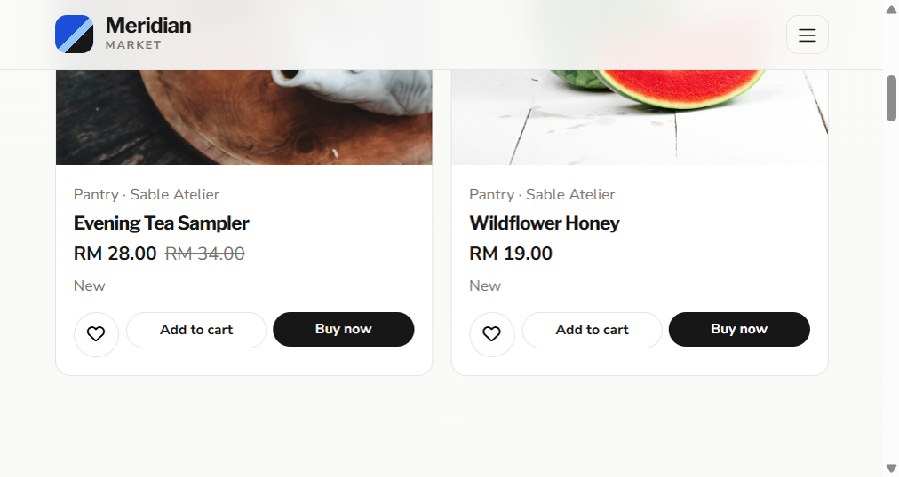
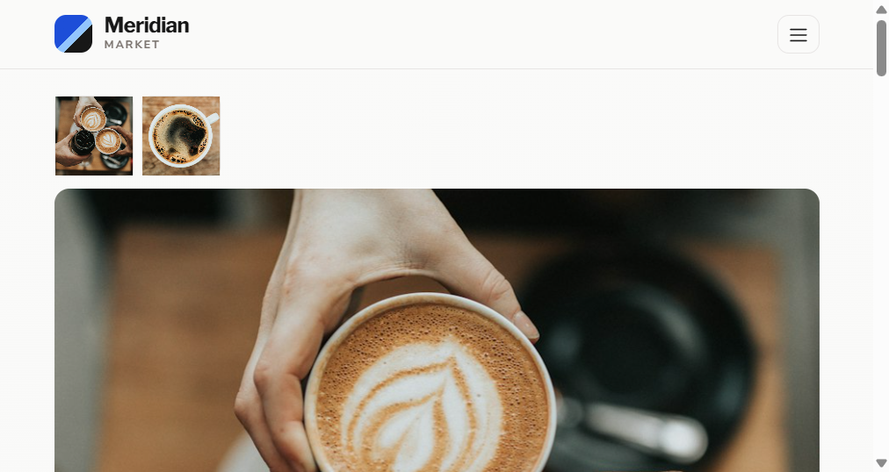
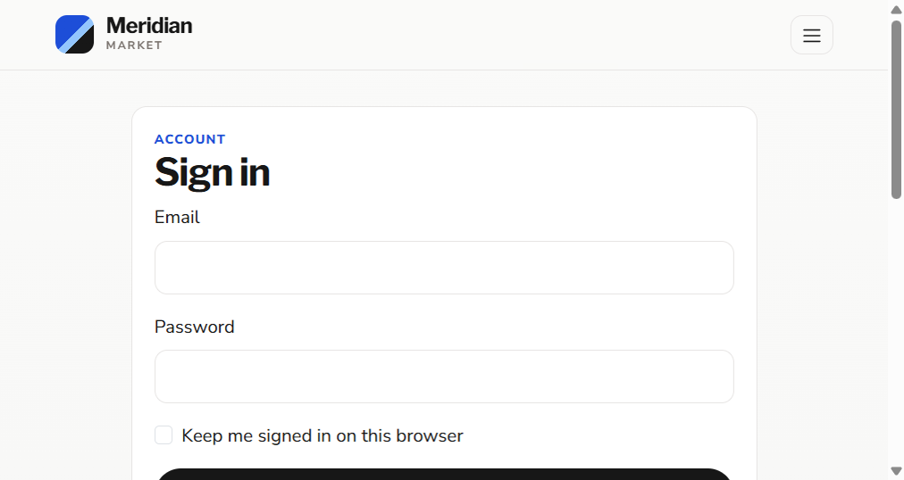

# Meridian Market

Meridian Market is a multi-vendor e-commerce marketplace. Customers browse independent makers, keep a wishlist, apply coupons, and check out with cash on delivery, a bank-transfer placeholder, or PayPal. Approved sellers manage only their own listings. Administrators run the marketplace from a separate dashboard.

The application is plain PHP 8.3+ and MySQL. It does not require Composer, npm, or a PHP framework.

## Screenshots

### Home


### Shop



### Product detail



### Sign in



### Sample catalog photos

| Carafe | Weekender | Tea sampler | Home category |
| --- | --- | --- | --- |
|  |  |  |  |

## Features

- Customer accounts with registration, login, profile, and password reset
- Shop search, category, price, stock, and rating filters, plus sorting and pagination
- Product galleries, related products, and purchaser-only reviews
- Persistent wishlist and shopping cart stored in MySQL
- Percentage and fixed coupons, flat shipping, and free shipping over a threshold
- Checkout that prices every line from the database and reserves stock inside a transaction
- PayPal Sandbox orders that are marked paid only after the server captures the payment
- Order history, timeline, and cancellation that restores stock
- Seller dashboard for products, images, stock, and that seller's order lines
- Admin dashboard for users, sellers, categories, products, coupons, orders, reviews, and sales

## Technology stack

- PHP 8.3 or newer, PDO, sessions, `password_hash()` and `password_verify()`
- MySQL 8 or MariaDB
- HTML5, CSS3, vanilla JavaScript
- Bootstrap 5, Font Awesome, and Google Fonts from their CDNs

## Requirements

- Apache with `mod_rewrite` (XAMPP or cPanel)
- PHP 8.3+ with the `pdo_mysql` and `gd` extensions
- MySQL 8 or MariaDB
- A browser

## Installation

1. Install XAMPP and start Apache and MySQL.
2. Copy this folder to `C:\xampp\htdocs\E-commerc_system\` (or any folder name).
3. Create the database by importing `database/ecommerce_marketplace.sql` in phpMyAdmin.
4. If MySQL's root password is not empty, copy `.env.example` to `.env` and set `DB_PASS`.
5. Open `http://localhost/E-commerc_system/`.

The folder name is detected from the web root. You do not need to hard-code it. Set `APP_BASE_PATH` in `.env` only when auto-detection is wrong.

## XAMPP setup

1. Start Apache and MySQL from the XAMPP Control Panel.
2. Place the project under `htdocs`.
3. Visit `http://localhost/phpmyadmin`.
4. Import `database/ecommerce_marketplace.sql`. The script creates `meridian_market` and the sample rows.
5. XAMPP's default account is `root` with an empty password, which matches `config/db.php`.
6. Open the site. The address includes whatever folder name you used.

## Database setup

The SQL file creates the database, tables, indexes, foreign keys, and sample data:

- 10 categories
- 30 products with photographic sample images
- 5 customers, 3 sellers, 1 administrator
- 10 orders, coupons, reviews, wishlists, and notifications

Re-importing drops and recreates `meridian_market`. Do that only when you want to reset the sample marketplace.

The order-number counter column is named `seq_value`. MySQL 8 reserves `LAST_VALUE` for window functions, so that word cannot be a column name.

## cPanel deployment

1. Create a MySQL database and user in cPanel, and grant that user all privileges on the database.
2. In phpMyAdmin, select the new database. If the host blocks `CREATE DATABASE`, delete these two lines from the SQL file before import:

```sql
CREATE DATABASE IF NOT EXISTS meridian_market ...
USE meridian_market;
```

3. Import `database/ecommerce_marketplace.sql`.
4. Upload the project files. Do not upload `.env` from your PC if it contains local passwords.
5. Copy `.env.example` to `.env` on the server and set `DB_HOST`, `DB_NAME`, `DB_USER`, and `DB_PASS`. cPanel database names are often prefixed, such as `account_meridian`.
6. Set `APP_ENV=production`.
7. Point the domain or subdomain at the project folder. `APP_BASE_PATH` can stay empty when the site is the domain root.
8. Confirm `uploads/products` and `uploads/profiles` are writable by PHP.

## Configuration

Settings live in `config/` and can be overridden with environment variables or a `.env` file. Process environment variables win over `.env`.

| Variable | Purpose |
| --- | --- |
| `APP_ENV` | `development` or `production` |
| `APP_URL` | Optional absolute site URL |
| `APP_BASE_PATH` | Optional path prefix, such as `/E-commerc_system` |
| `DB_HOST`, `DB_PORT`, `DB_NAME`, `DB_USER`, `DB_PASS` | Database connection |
| `PAYPAL_MODE`, `PAYPAL_CLIENT_ID`, `PAYPAL_CLIENT_SECRET`, `PAYPAL_CURRENCY`, `PAYPAL_API_BASE` | PayPal |
| `MAIL_HOST`, `MAIL_PORT`, `MAIL_USERNAME`, `MAIL_PASSWORD`, `MAIL_ENCRYPTION`, `MAIL_FROM_ADDRESS`, `MAIL_FROM_NAME` | SMTP |

Shipping is `$8.00`, and it is free when the pre-discount subtotal is at least `$150.00`. Change those amounts in `config/app.php`.

`.env` is listed in `.gitignore`. Do not commit passwords or PayPal secrets.

## Admin login

Development administrator:

- Email: `avery.quinn@meridianmarket.test`
- Password: `ChangeMe!Meridian2026`

The account is flagged `must_change_password`. The first login opens the password page and blocks the rest of the admin area until the password is changed. Replace this password before any shared or public deployment.

Seller sample password: `Maker#Studio88`

| Seller | Email | Shop |
| --- | --- | --- |
| Lila Brook | `lila.brook@cedarclay.example` | Cedar & Clay |
| Owen Park | `owen.park@northline.example` | Northline Goods |
| Nora Kim | `nora.kim@sableatelier.example` | Sable Atelier |

Customer sample password: `Harbor#Lane88`

| Customer | Email |
| --- | --- |
| Elena Voss | `elena.voss@example.com` |
| Marcus Hale | `marcus.hale@example.com` |
| Priya Nandakumar | `priya.nandakumar@example.com` |
| Jonah Ellison | `jonah.ellison@example.com` |
| Amira Soltani | `amira.soltani@example.com` |

Sample coupons: `WELCOME10` (10 percent, minimum $40, maximum discount $25), `MAKER25` ($25 off, minimum $120), `STUDIO15` (15 percent, minimum $80, maximum $40). `ARCHIVE20` is inactive.

## Customer workflow

1. Browse the home page, shop, and product pages without signing in. Guests can add items to a session cart; checkout and wishlist need an account.
2. Register or sign in at `public/login.php`. Registration asks for name, email, phone, and password. Add the shipping address later in Profile or at checkout. Customers land on the shop.
2. Search and filter on `public/shop.php`, then open a product.
3. Add the product to the wishlist or the cart. Quantity cannot exceed stock.
4. On the cart page, apply or remove a coupon. Totals are recalculated on the server.
5. Checkout collects the shipping contact and a payment method.
6. Cash on delivery and bank transfer create a pending order and reserve stock immediately.
7. PayPal sends the customer to PayPal and marks the order paid only after this server captures the payment.
8. Order history and the timeline are under `public/orders.php`.
9. Pending and paid orders can be cancelled. Cancellation restores stock and keeps the order row.
10. A customer can review a product after purchasing it, and can edit that review later.

## Seller workflow

1. Sign in with a seller account. The session opens `seller/dashboard.php`.
2. Add a product with one or more images, price, stock, category, and SKU.
3. Edit stock, deactivate a listing, or retire it. Listings that already appear on orders are archived instead of deleted.
4. Open Orders to see lines that belong to that seller. A seller cannot change another seller's product by editing the URL, and cannot change the marketplace order status.

## Admin workflow

1. Sign in and set a new administrator password.
2. The dashboard shows users, sellers, products, orders, revenue, recent orders, and simple sales charts.
3. Users can be searched, viewed, activated, suspended, or moved between customer and seller. The last active administrator cannot be removed.
4. Categories can be added and edited. A category that still contains products cannot be deleted.
5. Products can be featured, deactivated, or archived. Products with order history are not hard-deleted.
6. Coupons support percent and fixed discounts, a minimum spend, a maximum discount, a usage limit, and dates.
7. Orders can move through pending, paid, processing, shipped, completed, and cancelled. PayPal orders become paid only through server-side capture. Cancelling restores stock.
8. Reviews can be hidden or deleted.

## PayPal Sandbox setup

PayPal stays off until sandbox keys are present. COD and bank transfer still work.

### Option A — Admin screen

1. Sign in as the administrator.
2. Open **PayPal** in the admin sidebar (`admin/paypal.php`).
3. Paste the sandbox Client ID and Secret, set currency to `USD`, and set `APP_URL` to your site root (for local PHP server: `http://127.0.0.1:8091`).
4. Click **Save settings**, then **Test API connection**.

### Option B — `.env` file

```
PAYPAL_MODE=sandbox
PAYPAL_CLIENT_ID=your_sandbox_client_id
PAYPAL_CLIENT_SECRET=your_sandbox_secret
PAYPAL_CURRENCY=USD
APP_URL=http://127.0.0.1:8091
```

`PAYPAL_API_BASE` can stay empty. Sandbox uses `https://api-m.sandbox.paypal.com`.

### Get keys

1. Create a REST app at [PayPal Developer Sandbox Apps](https://developer.paypal.com/dashboard/applications/sandbox).
2. Copy the **Sandbox** client ID and secret.
3. Under Sandbox → Accounts, use a **Personal** buyer account to approve payments.

### Flow

1. Customer checks out with PayPal.
2. Meridian creates a PayPal order and redirects to PayPal.
3. Buyer approves with the sandbox personal account.
4. Return hits `public/payment_success.php`.
5. The server captures and verifies amount, currency, and order reference, then marks the order paid.

The client secret is never printed into JavaScript. A browser success message alone does not mark an order paid.
If the customer cancels at PayPal, `public/payment_cancel.php` cancels the unpaid order and releases reserved stock.

## Email setup

Password reset, registration, and order messages use SMTP when `MAIL_HOST` is set. Typical values are port `587` and encryption `tls`.

If `MAIL_HOST` is empty and `APP_ENV` is `development`, the message, including a password-reset link, is written to `logs/app.log` and the page still succeeds. In production, the message body is not written to the log. Missing mail settings do not stop checkout.

## Security

- PDO prepared statements and server-side role checks
- CSRF tokens from `random_bytes()`, compared with `hash_equals()`
- HTML escaping through `e()`
- Passwords stored with `password_hash()` (bcrypt)
- Login lockout after repeated failures
- Session cookies are HttpOnly and SameSite=Lax, and the session stores only the user id
- Uploads are checked for extension, MIME type, size, and dimensions, then re-encoded with GD
- Product prices, discounts, stock, seller ids, and payment status are read from MySQL, not from the browser
- Stock updates use a transaction and `SELECT ... FOR UPDATE`, and the decrement requires `stock >= quantity`
- PayPal capture is idempotent: a second success callback does not capture twice
- `config/`, `includes/`, `database/`, `logs/`, and `tools/` are blocked by `.htaccess`
- `uploads/.htaccess` refuses PHP execution

Development errors go to `logs/app.log`. Pages show a short message instead of SQL, paths, or secrets. Set `APP_ENV=production` on a public server.

## Troubleshooting

| Symptom | What to check |
| --- | --- |
| Setup required page | Import `database/ecommerce_marketplace.sql`. Confirm `DB_NAME` is `meridian_market` unless you renamed it. |
| Database connection error | MySQL is running. `DB_PASS` in `.env` matches the account. XAMPP's default password is empty. |
| SQL import error near `last_value` | Import the current SQL file. The counter column is `seq_value`. |
| Links missing the folder name | Set `APP_BASE_PATH` to the folder under `htdocs`, with a leading slash. |
| PayPal choice disabled | Add sandbox credentials, or use cash on delivery. |
| Password reset email missing | Read `logs/app.log` in development, or set `MAIL_HOST`. |
| Image upload fails | Enable PHP GD. Make `uploads/products` writable. Use JPG, PNG, or WEBP under 2 MB. |
| Blank page on the host | Set the PHP version to 8.3+ and confirm `pdo_mysql` is enabled. Read the host error log, not the public page. |

## Project structure

```
index.php                 Public home page
404.php                   Unknown routes
.htaccess                 Rewrite and directory protection
config/                   Database, PayPal, mail, app settings
includes/                 Auth, cart, orders, layouts, CSRF
public/                   Shop, cart, checkout, account
seller/                   Seller dashboard
admin/                    Admin dashboard
assets/                   CSS, JavaScript, category art
uploads/products/         Product images
uploads/profiles/         Profile images
database/                 ecommerce_marketplace.sql
logs/                     Application log (not committed)
tools/                    Media generator and self-check
```

## Testing

`tools/self_check.php` checks escaping, the admin password hash, coupon math, shipping, sample counts, search, seller ownership, stock reservation, order totals, and cancellation. Run it from the project folder:

```
php tools/self_check.php
```

Manual checklist:

- Register, duplicate email, bad login, logout, and password reset
- Search, filter, sort, and open a product
- Wishlist add, remove, and move to cart
- Cart quantity, remove, coupon apply, and coupon remove
- Checkout with cash on delivery, then view and cancel that pending order
- PayPal sandbox capture once credentials are present
- Review a purchased product
- Seller add, image upload, edit, stock change, and order list
- Admin user, category, product, coupon, order status, and review actions
- Guest visit to `admin/dashboard.php` and `seller/dashboard.php` redirects to login
- A seller cannot open another seller's product id

## Design notes

- Stock is reserved when the order is created, including unpaid PayPal and cash-on-delivery orders, so two checkouts cannot sell the same unit.
- Cancelling a pending, paid, or (for an administrator) processing order restores stock. Shipped, completed, and cancelled orders stay as they are.
- Products that appear on historical orders are archived. The order still shows the name and price saved at purchase.
- Sellers see their own lines and sales. They do not change the shared order status.
- Password-reset tokens are stored as SHA-256 hashes.
- Free shipping looks at the subtotal before the coupon.
